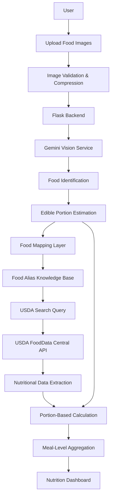
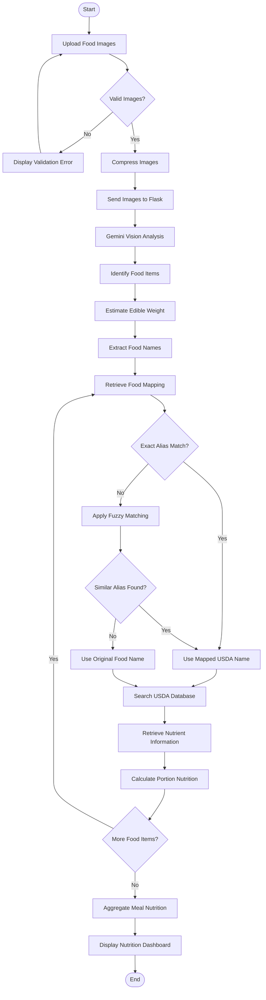

# 🥗 AI Nutrition Analysis

### Multimodal Food Recognition & Nutrition Estimation using Gemini, Retrieval-Based Food Mapping and USDA

<p align="center">
  
</p>

<p align="center">
  <b>Transform food images into estimated nutritional insights using multimodal AI and USDA FoodData Central.</b>
</p>

<p align="center">
  
  
  
  
  
  
</p>

---

## 📌 1. Project Overview

**AI Nutrition Analysis** is a multimodal AI application that identifies food items from uploaded meal images and estimates their nutritional composition.

The application combines Google's Gemini vision capabilities, a lightweight retrieval-based food mapping system, and USDA FoodData Central. Users can upload up to two food images; the system identifies visible food components, estimates edible portions in grams, retrieves corresponding nutritional information, and presents combined meal-level values.

### Problem Statement

Manual calorie and nutrient tracking requires users to identify food items, estimate portion sizes, and search nutritional databases individually. This project explores an automated approach using multimodal AI and external nutritional data retrieval to simplify meal analysis.

### Objectives

- Automate food identification from images.
- Estimate edible food quantities in grams.
- Map detected food names to suitable USDA search terms.
- Retrieve nutritional information from USDA FoodData Central.
- Calculate portion-based nutritional values.
- Aggregate individual food values into a combined meal summary.

## ✨ 2. Key Features

| Feature | Description |
|---|---|
| AI Food Recognition | Identifies multiple visible food items using Gemini. |
| Portion Estimation | Estimates edible quantities in grams. |
| Multiple Image Upload | Supports up to two food images per analysis. |
| Image Compression | Resizes and compresses images in the browser before submission. |
| Food Mapping | Uses predefined aliases and fuzzy matching to improve USDA search terms. |
| USDA Integration | Retrieves nutritional information from FoodData Central. |
| Nutrition Calculation | Calculates calories and nutrients based on estimated portions. |
| Meal-Level Aggregation | Combines nutritional values across identified food items. |
| Responsive Dashboard | Displays results through a desktop- and mobile-friendly interface. |

## 🛠️ 3. Technology Stack

| Category | Technology |
|---|---|
| Programming Language | Python 3.12 |
| Backend | Flask |
| Multimodal AI | Google Gemini API |
| AI SDK | Google Gen AI SDK |
| Retrieval Layer | Python dictionary, Difflib, food alias mapping |
| Nutrition Database | USDA FoodData Central API |
| Frontend | HTML, CSS, JavaScript |
| HTTP Requests | Requests |
| Environment Management | Python-dotenv |
| Deployment | Vercel |
| Version Control | Git and GitHub |

## 🧠 4. System Architecture

The application follows a modular processing architecture connecting image analysis, food-name retrieval, nutritional data extraction, portion calculation, and result aggregation.



### Architecture Components

1. **Frontend:** Accepts food images, validates the number of selected files, generates previews, compresses images, and displays nutrition results.
2. **Flask Backend:** Handles uploads, validates file formats and limits, coordinates AI identification and nutrition retrieval, and aggregates results.
3. **Gemini Vision Service:** Identifies individual food components, estimates edible portion weights, and returns structured JSON.
4. **Food Mapping Layer:** Loads predefined aliases, performs exact matching, applies fuzzy string matching, and generates USDA search terms.
5. **USDA Nutrition Service:** Searches food records, retrieves nutrient information, and calculates values according to estimated portions.

## 🔄 5. End-to-End Workflow



## 🔬 6. Technical Implementation

### 6.1 Image Upload and Preprocessing

The frontend supports up to two food images. JavaScript generates previews and uses the browser canvas to resize images while preserving their aspect ratio, then converts them into compressed JPEG files before submission.

The Flask backend performs additional validation and temporarily stores uploaded images for processing.

**Supported formats:** JPG, JPEG, PNG, WEBP.

### 6.2 Food Identification Using Gemini Vision

Google Gemini is used as the multimodal AI engine. The model receives the uploaded food image and structured instructions to:

- Identify individual visible food components.
- Separate different food items on the same plate.
- Estimate edible quantities in grams.
- Exclude non-edible components such as bones, pits, and shells.
- Return structured JSON.

Example response structure:

```json
{
  "foods": [
    {
      "name": "Cooked Rice",
      "estimated_edible_grams": 150
    },
    {
      "name": "Chicken Curry",
      "estimated_edible_grams": 120
    }
  ]
}
```

The application validates returned food names and estimated quantities before proceeding.

### 6.3 Retrieval-Based Food Mapping

The project implements a lightweight retrieval-based food mapping layer in `rag.py`. Its knowledge base is maintained in `knowledge/food_aliases.txt`.

Example mappings:

```text
roti => Chapati, whole wheat, commercially prepared
plain rice => Rice, white, long-grain, cooked
dal => Lentil soup
banana => Bananas, raw
```

The retrieval process has three stages:

1. **Exact matching:** Checks whether the detected food name exists in the alias dictionary.
2. **Fuzzy matching:** Uses Python's `difflib.get_close_matches()` to find a similar alias when an exact match is unavailable.
3. **Fallback:** Uses the original detected food name when no suitable alias is found.

**Implementation note:** The current code uses a local text knowledge base and fuzzy string matching. It does not currently use embeddings, a vector database, or ChromaDB.

### 6.4 USDA FoodData Central Integration

The USDA FoodData Central API provides nutritional information for identified food items. The application searches for a food record, selects a candidate using food-description matching, retrieves detailed nutrient information, and extracts available values.

| Nutrient | Unit |
|---|---|
| Energy | kcal |
| Protein | g |
| Carbohydrates | g |
| Fat | g |
| Fiber | g |

### 6.5 Portion-Based Nutrition Calculation

USDA nutritional values are retrieved per 100 grams. The application adjusts these values according to the estimated edible portion.

```text
Portion Nutrient = (Nutrient per 100 g × Estimated Portion in g) / 100
```

For example, if a food contains 130 kcal per 100 g and the estimated portion is 150 g:

```text
Calories = (130 × 150) / 100 = 195 kcal
```

The same calculation is applied to protein, carbohydrates, fat, and fiber.

### 6.6 Meal-Level Nutrition Aggregation

After calculating individual food values, the backend combines available nutritional information into one meal-level result.

```text
Total Calories = Sum of calories for all identified food items
```

The same aggregation is applied to other nutrients. If a nutrient is missing for any item, the current implementation reports that meal-level nutrient as unavailable rather than presenting an incomplete sum.

## 📊 7. Application Output

The application presents the analysis through a responsive nutrition dashboard.

| Output | Description |
|---|---|
| Identified Foods | Food components detected by Gemini |
| Total Calories | Combined estimated meal calories |
| Protein | Total estimated protein |
| Carbohydrates | Total estimated carbohydrates |
| Fat | Total estimated fat |
| Fiber | Total estimated fiber |

### Application Screenshots

Add screenshots captured from the running application to the following locations:

| Asset | Suggested Filename |
|---|---|
| Main application dashboard | `assets/dashboard.png` |
| Food image upload | `assets/food-upload.png` |
| Nutrition analysis results | `assets/nutrition-results.png` |

Example Markdown for screenshots:

```markdown


```

**Note:** Nutritional values depend on AI-based food identification, estimated portion sizes, and the selected USDA food records. They are estimates, not laboratory measurements.

## 📁 8. Repository Structure

```text
ai_nutrition_analysis/
│
├── app.py
├── gemini_service.py
├── rag.py
├── usda_api.py
│
├── requirements.txt
├── .python-version
├── .gitignore
├── vercel.json
├── README.md
│
├── assets/
│   ├── nutrition-analysis-banner.png
│   ├── dashboard.png
│   ├── food-upload.png
│   └── nutrition-results.png
│
├── knowledge/
│   └── food_aliases.txt
│
├── templates/
│   └── index.html
│
└── public/
    └── favicon.png
```

### Important Files

| File | Responsibility |
|---|---|
| `app.py` | Flask application and main processing pipeline |
| `gemini_service.py` | Gemini image analysis and food identification |
| `rag.py` | Food alias retrieval and fuzzy matching |
| `usda_api.py` | USDA API integration and portion calculations |
| `food_aliases.txt` | Food-name mapping knowledge base |
| `index.html` | Frontend interface and image compression |
| `requirements.txt` | Python dependencies |
| `vercel.json` | Vercel deployment configuration |
| `.python-version` | Python runtime specification |

## ⚙️ 9. Installation and Local Setup

### Prerequisites

- Python 3.12
- Git
- Google Gemini API key
- USDA FoodData Central API key

### Step 1: Clone the Repository

```bash
git clone https://github.com/VaibhavGovindwar/ai_nutrition_analysis.git
cd ai_nutrition_analysis
```

### Step 2: Create a Virtual Environment

```bash
python -m venv venv
```

Activate on Windows:

```bash
venv\Scripts\activate
```

Activate on Linux/macOS:

```bash
source venv/bin/activate
```

### Step 3: Install Dependencies

```bash
pip install -r requirements.txt
```

### Step 4: Configure API Keys

Create a `.env` file in the root directory:

```env
GEMINI_API_KEY=your_gemini_api_key
GEMINI_MODEL=your_configured_gemini_model
USDA_API_KEY=your_usda_api_key
```

Replace the placeholder values with your actual API credentials. Keep `.env` private and never upload API keys to GitHub.

### Step 5: Run the Application

```bash
python app.py
```

Open the application at:

```text
http://127.0.0.1:5000/
```

## ☁️ 10. Vercel Deployment

The application includes a Vercel configuration for Flask deployment.

1. Push the project repository to GitHub.
2. Import the repository into Vercel.
3. Configure the following environment variables:

| Variable | Purpose |
|---|---|
| `GEMINI_API_KEY` | Google Gemini authentication |
| `GEMINI_MODEL` | Gemini model selection |
| `USDA_API_KEY` | USDA API authentication |

4. Deploy the application.
5. Test image uploads and nutrition analysis using the deployed URL.

The repository includes `vercel.json` for deployment configuration and `.python-version` specifying Python 3.12. Uploaded images are stored temporarily under `/tmp` during serverless processing.

## ⚠️ 11. Limitations

- Food identification depends on the accuracy of Gemini's visual interpretation.
- Portion-size estimation is approximate and may differ from actual food weight.
- Similar-looking food items may be incorrectly identified.
- USDA database records may not perfectly match regional recipes or preparation methods.
- Nutrient availability depends on the selected USDA record.
- The current alias-matching system relies on predefined mappings and fuzzy string matching.
- A maximum of two images is supported per analysis.
- Internet connectivity is required for Gemini and USDA API access.

**Disclaimer:** This application is developed for educational and informational purposes. Nutritional values are AI-generated estimates and should not be treated as medically verified measurements or personalized medical advice.

## 🚀 12. Future Enhancements

- Implement embedding-based semantic food retrieval.
- Integrate a vector database for advanced food-name matching.
- Improve portion estimation using dedicated computer vision techniques.
- Expand the knowledge base for regional Indian dishes.
- Improve food matching for different cooking methods and recipes.
- Add food-wise nutritional breakdown.
- Introduce meal history and nutrition tracking.
- Support additional nutritional parameters and micronutrients.

## 👨‍💻 13. Author

**Vaibhav Govindwar**  
M.Tech Data Science | AI & Machine Learning Enthusiast

Interested in Artificial Intelligence, Machine Learning, Deep Learning, Generative AI, Retrieval-Augmented Generation, and Data Science.

<p align="center">
  <a href="https://github.com/VaibhavGovindwar">GitHub</a> ·
  <a href="https://www.linkedin.com/in/vaibhav-govindwar">LinkedIn</a>
</p>

---

<p align="center">
  <b>AI Nutrition Analysis</b><br>
  Transforming food images into nutritional insights using AI.
</p>
